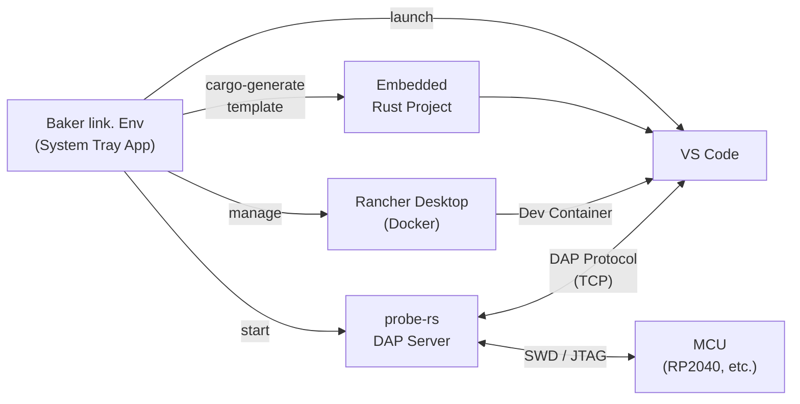

# Baker link. Env

[English](README.md) | [日本語Help](README.ja.md)

[](https://dioxuslabs.com)
[](LICENSE)
[]()

<a href="https://www.buymeacoffee.com/Bakerlink.Lab" target="_blank"></a>

<div align="center">


**Development environment assistant for embedded Rust with Baker link. series boards**

</div>


---

## Overview

**Baker link. Env** is a desktop application that automates the setup of an embedded Rust development environment. It bridges VS Code Dev Containers (running inside Docker) with a probe-rs DAP server running on the host, allowing you to write, build, and debug embedded Rust code entirely within a container — without touching your host Rust toolchain.


---

## How It Works



1. **Create Project** — generates a template-based embedded Rust project via `cargo-generate` and opens it in VS Code.
2. **Dev Container** — VS Code attaches to a Docker container that provides the full Rust toolchain and build environment.
3. **probe-rs DAP Server** — Baker link. Env starts a DAP server on the host that VS Code connects to over TCP for debugging.
4. **Debug** — breakpoints, step-through, and live memory inspection work seamlessly between the container and the physical MCU.

---

## Features

| Feature | Description |
|---|---|
| **Project creation** | One-click project scaffolding from a Git template via `cargo-generate` |
| **VS Code integration** | Automatically opens the new project in VS Code |
| **probe-rs DAP Server** | Start/stop a local DAP server with configurable port |
| **ELF transfer** | Transfers the container-built ELF to the host before each debug session |
| **Docker management** | Detects Rancher Desktop status and offers to start it |
| **Project history** | Quick access to recent projects from the UI and system tray |
| **System tray** | Runs as a tray-resident app — control DAP server and open projects without opening the window |

---

## Requirements

- [Rancher Desktop](https://rancherdesktop.io/) (provides Docker)
- [Visual Studio Code](https://code.visualstudio.com/)
- [Dev Containers extension](https://marketplace.visualstudio.com/items?itemName=ms-vscode-remote.remote-containers)
  installed in the host's VS Code. On Windows/Linux, make the `code` command
  available on PATH. On macOS, the app uses the VS Code CLI bundled in
  `/Applications` or `~/Applications`, or `code` on PATH.

---

## Install

### Building from Source

Use Dioxus CLI **0.7.10**, matching the Dioxus dependencies pinned in
`Cargo.toml`. Installing the latest CLI can cause a version incompatibility
error during bundling.

```sh
cargo install dioxus-cli --version 0.7.10 --locked --force
dx --version
dx bundle --release --package-types deb
```

When updating Dioxus, update both dependencies and the CLI version in the
release workflow together.

Installers for Windows, macOS, and Ubuntu are available on the [Releases](https://github.com/Baker-link-Lab/baker-link-env/releases) page.

### macOS: "Damaged App" Error

If macOS shows a "damaged" warning after installing, run:

```sh
xattr -d com.apple.quarantine "/Applications/Baker link. Env.app"
```

---

## Usage

### Environment Doctor

Doctor automatically checks the host once on application startup. If any
checks need attention (or diagnosis cannot complete), the Doctor screen opens
with a dismissible notification. Successful startup checks leave Home visible.
The splash screen may appear briefly before the results are shown.
Use **Back to Home** to return without changing settings. Notifications and
confirmation popups have a **×** close button.

Open **Doctor** in the top bar and click **Run checks** to diagnose again:

- VS Code CLI availability.
- Dev Containers extension installed in the host VS Code.
- Docker CLI availability and Docker Engine connectivity.
- Active Docker runtime compatibility with Baker Link host networking.

Each item displays **Passed**, **Needs attention**, or **Not checked**, with
diagnostic details and setup links where applicable. Checks that depend on a
missing tool or unavailable engine are marked **Not checked**, not failed.
Use **Copy report** to copy the timestamped results; inspect command output
for local paths or host names before sharing it.

Choose **English** or **日本語** in the top bar to change the entire app's
display language. Your selection is saved for the next launch. Buttons,
descriptions, status labels, Doctor results, notifications and application
log messages change immediately, including existing diagnosis results.
Help opens the README in the selected language; copied reports use it too.
Product names, commands, paths, device identifiers and external tools' raw
diagnostic output are preserved so they can be used for troubleshooting.
Native file-dialog controls follow the operating system's language.
Resetting settings returns the language to English.

For a failed check,
click **Read setup steps** to open the matching section of this README (or the
Japanese README) in your browser. After following the steps, return to Doctor
and click **Run checks**. The startup notification also links to the setup guide.
Online Help requires internet access and documentation published to `main`.

Doctor is read-only: it does not install software, start Docker, alter
settings/firewalls, or recreate containers. Commands run off the UI thread
with a 15-second timeout per command. After resolving an issue, run checks
again. A passing result means the host tools/runtime are available, not that
debugging is verified. Project configuration, container connections, host
service ports, and USB devices are deliberately outside its scope.

## doctor-start-here

### First-time setup: what to do when Doctor shows a problem

You need three things on your computer: **VS Code** (the editor),
**Dev Containers** (a VS Code extension), and **Docker** (the container engine).
You do not need to install a host Rust toolchain just to use generated projects.

1. Read the first **Needs attention** item in Doctor. This is the item to fix.
   **Not checked** means a required earlier check could not complete; it does
   not mean you have another independent problem.
2. Click **Read setup steps** on that item, or choose a section below.
3. Follow the numbered steps for your OS. If you changed PATH (the list of
   folders where commands are found), fully exit and reopen Baker Link Env.
4. Return to **Doctor → Run checks**. Repeat until all items show **Passed**.
   **Back to Home** returns to the project screen.

| Doctor item | Instructions |
|---|---|
| VS Code | [Install / enable VS Code CLI](#doctor-vscode) |
| Dev Containers | [Install the host extension](#doctor-dev-containers) |
| Docker CLI | [Install Docker / enable its CLI](#doctor-docker-cli) |
| Docker Engine | [Start Docker / check its connection](#doctor-docker-engine) |
| Host networking support | [Choose a supported runtime](#doctor-host-networking) |

If diagnosis itself fails or the problem remains, click **Run checks** again,
then **Copy report** and ask for help with the error details. Review the report
for private paths/host names before posting it.

## doctor-vscode

### VS Code cannot be found or executed

1. Install [Visual Studio Code](https://code.visualstudio.com/download) for
   your OS. Open it once to confirm installation.
2. **Windows:** enable **Add to PATH** in the installer. If VS Code is already
   installed, run its installer again and enable that option.
   **macOS:** keep the app in `/Applications` or `~/Applications`. For other
   locations, open VS Code's Command Palette (`Cmd+Shift+P`) and run
   **Shell Command: Install 'code' command in PATH**.
   **Debian:** follow the [official Linux installation guide](https://code.visualstudio.com/docs/setup/linux)
   and ensure `code` is available.
3. In a new host terminal (PowerShell on Windows, Terminal on macOS/Debian),
   run `code --version`. It should print a version, not "command not found".
4. Fully exit and reopen Baker Link Env, then run Doctor again.

If this still fails, expand **Details** in Doctor. A permission error or timeout
does not necessarily mean VS Code is missing.

## doctor-dev-containers

### Install Dev Containers in the host VS Code

1. Open VS Code on your computer, **not** a window connected to a container.
2. Open Extensions (`Ctrl+Shift+X`; `Cmd+Shift+X` on macOS).
3. Search for **Dev Containers** by **Microsoft**. Its identifier is
   `ms-vscode-remote.remote-containers`.
4. Click **Install**. [Open the extension page](https://marketplace.visualstudio.com/items?itemName=ms-vscode-remote.remote-containers)
   if you cannot find it. Reload VS Code if prompted.
5. Return to Baker Link Env and click **Doctor → Run checks**.

If Doctor says it could not list extensions, fix the VS Code CLI first and
check **Details**. Ensure the extension is in the same VS Code installation
and default profile used by the `code` CLI.

## doctor-docker-cli

### Install Docker and make the docker command available

1. For an easy starting point, install
   [Rancher Desktop for your OS](https://docs.rancherdesktop.io/getting-started/installation/).
   Docker Desktop is also supported. On Debian, local, rootful
   [Docker Engine](https://docs.docker.com/engine/install/debian/) is supported.
2. Open Rancher Desktop and choose **dockerd (moby)** as the container engine.
   `containerd` alone does not provide the Docker API used by this app.
   On Windows, follow its WSL 2 prerequisites; if requested, complete setup
   and restart Windows. With Docker Desktop, use **Linux containers**.
3. Follow the runtime's PATH setup instructions. On Windows, ensure its
   Docker CLI folder is in your user PATH; on macOS/Linux, enable its CLI
   links or add the documented CLI folder to PATH.
4. In a new host terminal, run `docker --version`. It should print a version.
5. Fully exit and reopen Baker Link Env, then run Doctor again.

Install only one runtime if you are unsure which to use. Docker CLI availability
alone does not mean its engine is running; continue with the next section.

## doctor-docker-engine

### Docker is installed but its engine cannot be reached

1. Open the Docker runtime you installed and wait until it reports ready.
   On Debian with native Docker Engine, follow its service startup instructions.
2. In a host terminal, run `docker info`. It should show server information.
3. If it fails, run `docker context ls` to see the selected engine (marked `*`).
   If needed, use `docker context use NAME`, replacing `NAME` with the context
   belonging to your installed runtime. Do not select an unrelated remote server.
4. For a socket permission error on Debian, follow the
   [official post-installation steps](https://docs.docker.com/engine/install/linux-postinstall/).
   Docker group membership grants powerful host access; understand that warning.
   Log out and back in if the instructions require it.
5. Return to Baker Link Env and click **Doctor → Run checks**.

If **Details** reports malformed output or a timeout, verify `docker info`
in the terminal and update/repair your Docker runtime before retrying.
Doctor does not start Docker automatically.

## doctor-host-networking

### Use a runtime supported by automatic host networking

1. Use **Rancher Desktop / Docker Desktop with Linux containers** on Windows
   or macOS, or local, rootful **Docker Engine** on Debian.
2. Windows containers, rootless native Docker, and remote native Docker engines
   need a different connection setup; automatic host networking does not support
   them. Do not change IP addresses at random or disable the firewall.
3. Check `docker context ls` and `docker info` in a host terminal. Ensure they
   refer to the intended runtime, then click **Doctor → Run checks**.

A **Passed** result here checks runtime compatibility only. It does not prove
that a running container can reach the host ports or that an MCU is connected.

## Using Projects

### 1. Create a Project

1. Enter a project name in the **Create Project** panel.
2. Click **Create** and choose a parent folder.
3. The app generates the project from the template and opens it directly in
   VS Code's Dev Container. The extension builds/starts the container on the
   first open; you do not need to select **Reopen in Container**.
   The template includes host endpoints in the `bakerLink` object in
   `.vscode/launch.json`; edit them if your host connection settings differ.
   The template automatically installs Baker Link Env from the Marketplace
   inside the Dev Container. Wait for installation to finish before debugging.

Opening a project from **History** uses the same behavior. Projects without
`.devcontainer/devcontainer.json` or `.devcontainer.json` open as local folders.
For direct container opening, the configuration must specify an absolute
`workspaceFolder`; `${localWorkspaceFolderBasename}` is supported. Missing or
invalid workspace settings produce an error instead of opening the wrong folder.
If Docker is not running, the app starts Rancher Desktop and waits up to
60 seconds for Docker to become ready. Longer startup requires trying again.

### Cross-platform Host Networking

The container uses `host.docker.internal` for both host services on Windows,
macOS, and Debian. When opening a Baker Link template project, the app inspects
the active Docker engine and updates `.docker/compose.host.yaml`:

- Rancher Desktop / Docker Desktop: keep the runtime's native host DNS.
- Debian / other Linux with local, rootful Docker Engine: add
  `host.docker.internal:host-gateway`.

Do not add an unconditional `host-gateway` mapping to the base Compose file:
on Windows with Rancher Desktop it can point to the Linux Docker bridge rather
than Windows. The app migrates the previous template's exact mapping and adds
the host override to the Dev Container configuration. Other projects are not
rewritten. Rootless Docker, Windows containers, and remote native Docker engines
require a separate connection setup and are not supported by this automatic mode.

Reopen through Baker Link Env after moving a project to another host/runtime,
then use **Dev Containers: Rebuild Container** to apply network changes to an
existing container. The app does not recreate containers itself. Projects
generated without opening initially have the desktop-safe override; opening
through the app configures it for the active engine.

For a manual VS Code open, configure the override as described in the
[template README](template/bakerlink_tutorial_template/README.md).
Start the desktop app's services with **Run** and use the extension's
**Baker Link: Check Host Connection** to verify both ports. Keep Bind IP at
`0.0.0.0` for container access and limit firewall access to trusted networks.

### 2. Start the DAP Server

1. Optionally change **Bind IP**, **DAP Port**, or **ELF Upload Port**. The defaults are `0.0.0.0`, `50001`, and `50002`.
2. Click **Run**. The app saves these values and starts both services.
3. The template connection settings default to `host.docker.internal`,
   `50001`, and `50002`. If the app uses different ports, edit
   `bakerLink.dapServer` and `bakerLink.uploadUrl` in `.vscode/launch.json`
   to match before debugging.
4. Press `F5`. The pre-launch task builds the ELF; the Baker Link Env extension
   uploads it before connecting to probe-rs.

No host path mapping or `LOCAL_WORKSPACE_FOLDER` environment variable is required.

### VS Code Extension

[Baker Link Env](https://marketplace.visualstudio.com/items?itemName=baker-link-lab.baker-link-env)
is available from the VS Code Marketplace. The template's
`.devcontainer/devcontainer.json` automatically installs
`baker-link-lab.baker-link-env` inside the container.
For existing containers, update the configuration and run
**Dev Containers: Rebuild Container**, or install the extension manually from
the Extensions view in the Dev Container window.

The fork is maintained as the `external/baker-link-env-vscode` submodule.
For extension development, initialize submodules before building a local VSIX:

```sh
git submodule update --init --recursive
cd external/baker-link-env-vscode
npm ci
npm test
npm run package
```

To test a local development build, use **Extensions: Install from VSIX...**
in the project's Dev Container window.
Requires VS Code >= 1.116.0 and Node >= 22 for extension development.
The extension ID is `baker-link-lab.baker-link-env`; the debugger type is
`baker-link-debug`, separate from the official probe-rs extension.

The extension reads per-configuration endpoints from `.vscode/launch.json`, provides
**Baker Link: Check Host Connection** and **Baker Link: Open Connection Settings**,
and uploads the container-side `bakerLink.elf` after a successful build.
Keep `remoteServerMode: false` with `bakerlink://<project>/<profile>` artifacts.
Port checks are TCP reachability checks, not USB probe or application readiness
checks. The MVP does not add host start/stop control or automatic host startup.
See the extension's [README](external/baker-link-env-vscode/README.md) for
configuration and the template's [README](template/bakerlink_tutorial_template/README.md)
for migration from the old `.bakerlink` directory. Move non-default endpoints
to `bakerLink.dapServer` / `bakerLink.uploadUrl`, remove shell-upload tasks,
and delete `.bakerlink`. The extension handles uploads without project scripts.

### ELF Upload Troubleshooting

If the extension reports an ELF upload connection failure, start the host
services with **Run** in the desktop app and check endpoints in `.vscode/launch.json`.
Use **Baker Link: Check Host Connection** for TCP diagnostics and the
**Baker Link Env** output channel for errors. The extension does not start
the host services itself.

For Dev Containers, **Bind IP** must be reachable from Docker: use `0.0.0.0`
or a specific host interface accessible to the container, not `127.0.0.1`.
Settings from older versions without a saved Bind IP now default to `0.0.0.0`;
an explicitly saved address is preserved. Ensure the ELF upload port (default
`50002`) is allowed by the host firewall. On Linux, the container needs
`host.docker.internal:host-gateway` in its Docker extra hosts.

Binding to `0.0.0.0` exposes both services on all host interfaces. The ELF
upload and DAP services do not authenticate clients. Use a trusted network and
firewall rules to restrict access, and avoid exposing these ports to untrusted
networks.

## License

Copyright (c) 2024 Baker-Tanaka
Licensed under the [MIT](LICENSE) license.
