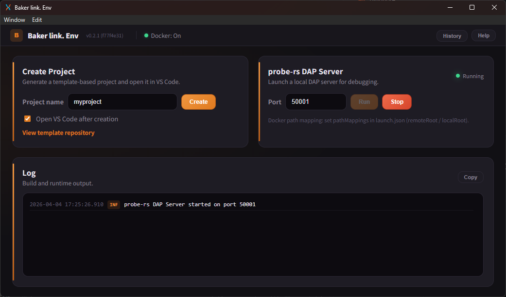
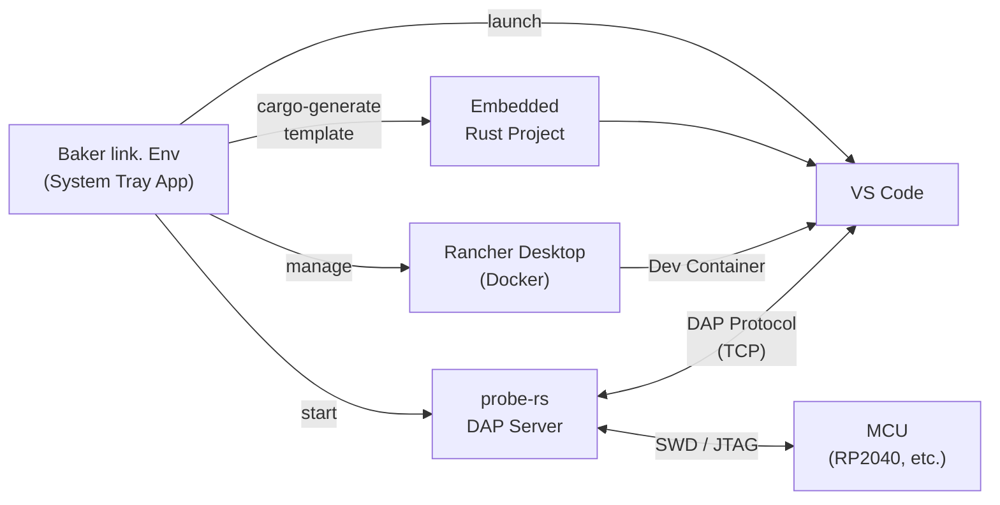

# Baker link. Env

[](https://dioxuslabs.com)
[](LICENSE)
[]()

<a href="https://www.buymeacoffee.com/Bakerlink.Lab" target="_blank"></a>

<div align="center">


**Development environment assistant for embedded Rust with Baker link. series boards**

</div>


---

## Overview

**Baker link. Env** is a desktop application that automates the setup of an embedded Rust development environment. It bridges VS Code Dev Containers (running inside Docker) with a probe-rs DAP server running on the host, allowing you to write, build, and debug embedded Rust code entirely within a container — without touching your host Rust toolchain.



---

## How It Works



1. **Create Project** — generates a template-based embedded Rust project via `cargo-generate` and opens it in VS Code.
2. **Dev Container** — VS Code attaches to a Docker container that provides the full Rust toolchain and build environment.
3. **probe-rs DAP Server** — Baker link. Env starts a DAP server on the host that VS Code connects to over TCP for debugging.
4. **Debug** — breakpoints, step-through, and live memory inspection work seamlessly between the container and the physical MCU.

---

## Features

| Feature | Description |
|---|---|
| **Project creation** | One-click project scaffolding from a Git template via `cargo-generate` |
| **VS Code integration** | Automatically opens the new project in VS Code |
| **probe-rs DAP Server** | Start/stop a local DAP server with configurable port |
| **ELF transfer** | Transfers the container-built ELF to the host before each debug session |
| **Docker management** | Detects Rancher Desktop status and offers to start it |
| **Project history** | Quick access to recent projects from the UI and system tray |
| **System tray** | Runs as a tray-resident app — control DAP server and open projects without opening the window |

---

## Requirements

- [Rancher Desktop](https://rancherdesktop.io/) (provides Docker)
- [Visual Studio Code](https://code.visualstudio.com/)

---

## Install

Installers for Windows, macOS, and Ubuntu are available on the [Releases](https://github.com/Baker-link-Lab/baker-link-env/releases) page.

### macOS: "Damaged App" Error

If macOS shows a "damaged" warning after installing, run:

```sh
xattr -d com.apple.quarantine "/Applications/Baker link. Env.app"
```

---

## Usage

### 1. Create a Project

1. Enter a project name in the **Create Project** panel.
2. Click **Create** and choose a parent folder.
3. The app generates the project from the template and opens it in VS Code.
   The template includes `.bakerlink/connection.json` with the default host and
   ports; edit it and `.vscode/settings.json` in the generated project if your
   host connection settings differ.

### 2. Start the DAP Server

1. Optionally change **Bind IP**, **DAP Port**, or **ELF Upload Port**. The defaults are `0.0.0.0`, `50001`, and `50002`.
2. Click **Run**. The app saves these values and starts both services.
3. The template connection settings default to `host.docker.internal`,
   `50001`, and `50002`. If the app uses different ports, edit
   `.bakerlink/connection.json` and `.vscode/settings.json` in the project to
   match, then reopen it in its Dev Container.
4. Press `F5`. The pre-launch task builds and uploads the ELF before probe-rs starts debugging.

No host path mapping or `LOCAL_WORKSPACE_FOLDER` environment variable is required.

### ELF Upload Troubleshooting

If `.bakerlink/upload-elf.sh` reports `curl: (7)` / `Cannot connect`, start the
host services with **Run** in the desktop app. The upload script does not start
the host services itself.

For Dev Containers, **Bind IP** must be reachable from Docker: use `0.0.0.0`
or a specific host interface accessible to the container, not `127.0.0.1`.
Settings from older versions without a saved Bind IP now default to `0.0.0.0`;
an explicitly saved address is preserved. Ensure the ELF upload port (default
`50002`) is allowed by the host firewall. On Linux, the container needs
`host.docker.internal:host-gateway` in its Docker extra hosts.

Binding to `0.0.0.0` exposes both services on all host interfaces. The ELF
upload and DAP services do not authenticate clients. Use a trusted network and
firewall rules to restrict access, and avoid exposing these ports to untrusted
networks.

## License

Copyright (c) 2024 Baker-Tanaka
Licensed under the [MIT](LICENSE) license.
